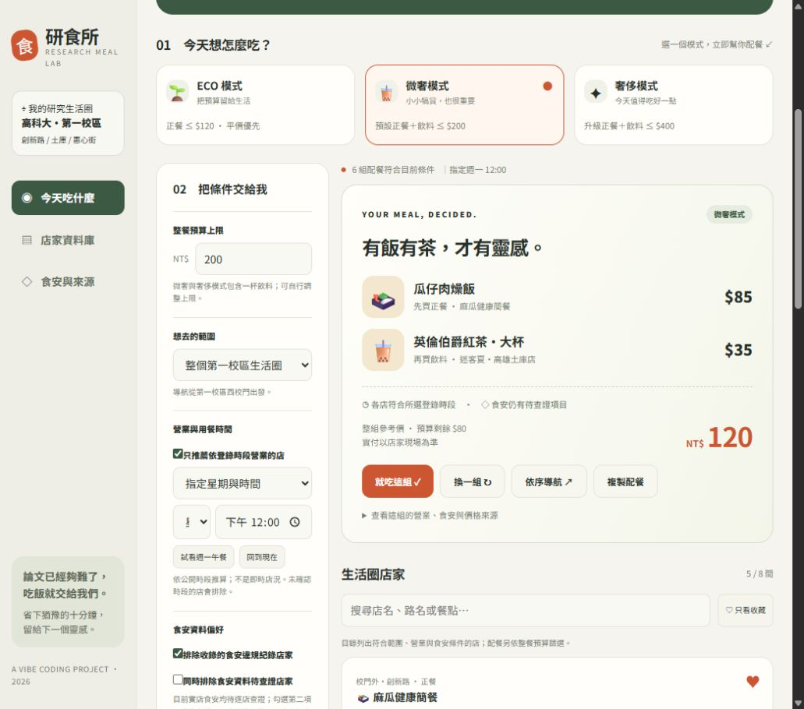

# 研食所 Research Meal Lab

研究可以燒腦，午晚餐不用。

以國立高雄科技大學第一校區周邊為範本的研究生配餐助手，提供 ECO、微奢、奢侈三模式，整合預算、營業時段、範圍與食安資料狀態。

- [開啟網站](https://f114112112-iyang.github.io/research-meal-lab/)
- [完整規格書](SPEC.md)
- [測試紀錄](TESTING.md)
- [資料來源](DATA-SOURCES.md)
- [AI 協作與修改紀錄](CHANGELOG.md)

## 使用方式

開啟網站，選一個模式即可配餐。也可調整總預算、用餐星期／時間、地區和食安條件，再按「幫我配好這一餐」。若當下太晚，可用「試看週一午餐」展示功能。

微奢模式先買一份正餐，再搭配一杯飲料；結果會列出總價，並可交由 Google Maps 依序導航。按「就吃這組」記錄用餐，點店家愛心可收藏。

## 預設模式

| 模式 | 預算上限 | 內容 |
| --- | --- | --- |
| ECO | $120 | 平價正餐 |
| 微奢 | $200 | 正餐＋飲料 |
| 奢侈 | $400 | 參考價至少 $180 的正餐＋飲料 |

## 資料說明

收錄 8 間生活圈實店，資料整理於 2026/10/19。價格為公開來源參考價，營業狀態由登錄時段推算，不能保證即時正確。

實店食安資訊皆標示「待查證」，並提供官方來源查詢入口；沒有把搜尋無結果當成安全，也不捏造違規案件。可切換獨立的虛構資料，測試有紀錄店家及未知資料排除。正式應用仍需建立持續更新的官方食安案件庫。

## 本機開啟

直接開啟 index.html 即可，不需安裝任何套件。也可在此資料夾執行：

```sh
python -m http.server 8766
```

網站的 CSS、JavaScript、SVG 與資料都在單一 index.html。其他 Markdown 文件、驗證程式與截圖僅供作業說明，不是網站執行依賴。

## 核心驗證

```sh
node verify.cjs
```

使用 Node.js 內建工具，無須 npm install。

## 畫面




## GitHub Pages

使用 main 分支根目錄發布。重新上傳 index.html 並提交後，Pages 會重新部署。
